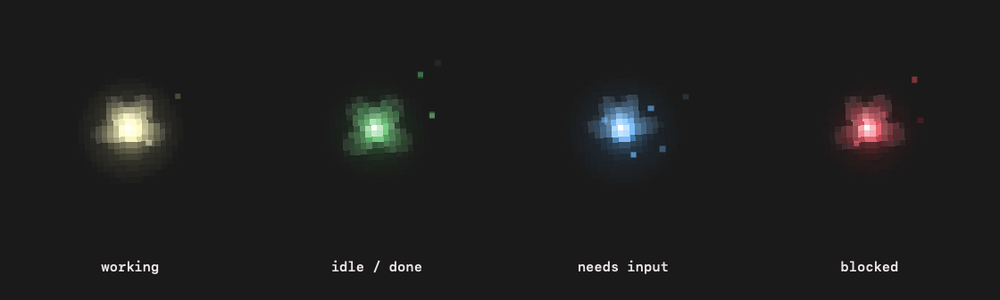
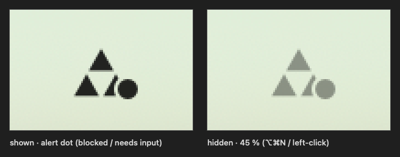

# Navi

A small glowing fairy that floats over every window on your Mac, follows your cursor, and
tells you with one color whether any of your coding agents need you.



Navi watches the agent sessions running on your machine — **Claude Code**, **Codex**, and
optionally **Omnigent** — and, if you point her at a git repo, its worktrees and pull
requests. Each piece of work in flight is one *build thread*: she turns yellow while an
agent is working, green when it finishes its turn and is waiting on you, blue when it asked
you something, red when something broke. Click her for the list; the last page of the menu
shows how much of each tool's quota you have used.

Everything runs locally. There are two parts:

| Part | Folder | What it does |
|---|---|---|
| **Collector** | `collector/` | A small Node daemon (no npm dependencies) that reads your agent sessions and writes one snapshot file, `~/.navi/threads.json`, within about half a second of anything changing. |
| **App** | `app/` | A Swift/AppKit app (no Dock icon, one menubar icon) that reads the snapshot and draws the fairy. |

## Requirements

- **macOS 14 (Sonoma) or newer**, Apple silicon or Intel.
- **Swift 5.9+** — Xcode 15+ or just the Command Line Tools (`xcode-select --install`).
- **Node 22.13 or newer** for the collector (it uses Node's built-in `WebSocket` and
  `node:sqlite`). Homebrew, nvm, Volta and `~/.local/bin` installs are found
  automatically; anything else, set `NAVI_NODE=/path/to/node`.
- **git**. Optional: the **GitHub CLI** (`gh`, signed in) for PR status on worktree rows.

## Install

```bash
git clone <this repo> navi && cd navi

# optional: track a repo's worktrees and PRs too
export NAVI_REPO=~/code/my-project

./install.sh --dry-run   # shows exactly what it will build, write and load
./install.sh
```

`install.sh` builds the app in release mode, wraps it as `~/Applications/Navi.app` (no Dock
icon, signed locally, see [Code signing](#code-signing)), and loads two per-user launchd
agents whose paths point at **this clone**:

| Agent | Runs | Log |
|---|---|---|
| `com.navi.collector` | `collector/run.sh` → `collect-daemon.mjs` (always kept running) | `~/Library/Logs/navi-collector.log` |
| `com.navi.app` | `~/Applications/Navi.app` (relaunched after a crash; a Quit from her menu stays quit) | `~/Library/Logs/navi.log` |

She appears bottom-right and follows the cursor. Drag her somewhere else and she remembers.
If you move the clone, run `./install.sh` again. On first launch macOS may ask whether Navi
may send notifications — allow it if you want the "is waiting on you" banners.

### Settings

launchd does not read your shell profile, so `install.sh` copies these from your environment
into both agents. Change one → re-run `./install.sh`.

| Variable | Default | Meaning |
|---|---|---|
| `NAVI_REPO` | *(unset)* | A git repo whose worktrees and PRs become rows. Without it, Navi still shows every live agent session, wherever it runs. |
| `NAVI_THREADS_PATH` | `~/.navi/threads.json` | The snapshot file. `notified.json`, `threads.prev.json` and `usage-cache.json` live next to it. |
| `NAVI_SFX_DIR` | `~/Library/Application Support/Navi/sfx` | Where Navi looks for your sound files (see [Sounds](#sounds)). |
| `NAVI_KEYSOUNDS_DIR` | `~/Library/Application Support/Navi/keysounds` | Typing-sound packs: where `install.sh` fetches them and Navi reads them (see [Typing sounds](#typing-sounds-and-typing-speed)). |
| `NAVI_NODE` | auto-detect | Node binary for the collector. |
| `NAVI_NOTIFY_CMD` | *(unset)* | Shell command run when a thread starts needing you (reviewed PR waiting on your merge, branch gone stale). The message is `"$1"`, e.g. `NAVI_NOTIFY_CMD='terminal-notifier -message "$1"'`. |
| `NAVI_NO_USAGE` | *(unset)* | `1` = never poll quota providers; the usage page stays empty. |

### Code signing

macOS ties the Input Monitoring grant (needed for [typing sounds](#typing-sounds-and-typing-speed))
to the app's code signature. An ad-hoc signature changes with every build, so with ad-hoc
signing you have to grant Input Monitoring again after each reinstall. To avoid that,
`install.sh` signs with a stable identity when your Mac has one:

1. `NAVI_SIGN_IDENTITY` set → it signs with that identity (`-` forces ad-hoc). If that fails,
   the install stops with an error.
2. Otherwise it picks the first valid **Apple Development** identity in your keychain
   (`security find-identity -v -p codesigning`, which only lists and never prompts). Create one
   for free in Xcode → Settings → Accounts → Manage Certificates.
3. No such identity, or signing with it fails → ad-hoc signing, with a note that Input
   Monitoring will reset on each install.

Nothing is hardcoded: no identity or team ID ships in this repo. Each `codesign` call is cut
off after `NAVI_SIGN_TIMEOUT` seconds (a whole number from 1 to 120; anything else falls back to the default 20 with a warning), so a Keychain access prompt left
unanswered can never stall the install; it just falls back to ad-hoc. The first install with a
stable identity needs one last re-grant (toggle Navi off and on under Input Monitoring); after
that, reinstalls keep it. These two variables are read at install time only and are not
baked into the agents.

```bash
security find-identity -v -p codesigning          # list the identities you have
NAVI_SIGN_IDENTITY="<one of them>" ./install.sh    # use a particular one
```

## What Navi reads

Everything is read-only. Every source is optional; a missing one is reported in the snapshot's
`sources` and the rest still work.

| Source | Where | Needed for |
|---|---|---|
| Claude Code sessions | `~/.claude/sessions/*.json` (Claude Code's own session registry) | Claude Code rows — works out of the box |
| Claude Code hook state *(optional)* | `~/.claude/agent-state/*.json` | Finer states — see [below](#optional-claude-code-hook) |
| Codex sessions | `~/.codex/state_*.sqlite` + the running `codex` processes | Codex rows |
| Omnigent *(optional)* | `http://127.0.0.1:6767` (its local API) | Omnigent chat rows; skipped if it is not running |
| git worktrees *(optional)* | `git worktree list` in `NAVI_REPO` | worktree rows, dirty / unpushed / behind-main facts |
| Pull requests *(optional)* | one `gh pr list` in `NAVI_REPO` | PR number, title, merged / open |
| Review verdicts *(optional)* | `NAVI_REPO/.polly/registry.json` (Omnigent's polly orchestrator) | "PR reviewed, waiting on your merge" |
| Process table | `ps` / `lsof` | Which sessions are actually alive right now |

**A row exists only while a live agent backs it.** Closed sessions, sub-agents (they fold
into their parent's row), archived chats, and worktrees nobody is working in never show up
in Navi. Rows are named for people: PR title, else branch name, else the session's title,
else the folder name.

### Quota usage page

The last menu page shows one row per tool that has a quota, using the credentials those tools
already stored on your Mac. Each is polled at most every 1–10 minutes; the cache holds numbers
only, never a token.

| Row | Credential it reuses |
|---|---|
| Claude Code | the `Claude Code-credentials` keychain item (macOS may ask once to allow access) |
| Codex | `~/.codex/auth.json` (falls back to `codex app-server`) |
| Cursor | the `cursor-access-token` keychain item |
| Antigravity | the running IDE's local language server |
| OpenRouter | `~/.hermes/.env` or `~/.pi/agent/auth.json` |
| Nous | `~/.hermes/auth.json` |
| Omnigent | its local API (dollars today, no quota) |

A tool you do not use just shows a short reason, dimmed (no key found, app not running). Don't want
any of this? `NAVI_NO_USAGE=1 ./install.sh`.

### Optional Claude Code hook

Claude Code's own registry says *busy* or *idle*, which is enough for yellow/green. If you
want *blue* for "Claude is asking permission", wire `collector/hooks/agent-state.sh` into
`~/.claude/settings.json` (use the absolute path of your clone):

```json
{
  "hooks": {
    "UserPromptSubmit": [{ "hooks": [{ "type": "command", "command": "/path/to/navi/collector/hooks/agent-state.sh running" }] }],
    "Stop":             [{ "hooks": [{ "type": "command", "command": "/path/to/navi/collector/hooks/agent-state.sh waiting" }] }],
    "Notification":     [{ "hooks": [{ "type": "command", "command": "/path/to/navi/collector/hooks/agent-state.sh blocked" }] }],
    "SessionEnd":       [{ "hooks": [{ "type": "command", "command": "/path/to/navi/collector/hooks/agent-state.sh gone" }] }]
  }
}
```

It writes `~/.claude/agent-state/<session_id>.json`, never prints anything, and always
exits 0, so it cannot block a prompt. Merge these into any hooks you already have.

## What her color means

| Color | State | Means |
|---|---|---|
| **yellow** `#fff8ad` | working | an agent is mid-turn right now |
| **green** `#3fb950` | idle / done | the agent finished its turn, or nothing is going on |
| **blue** `#4aa8ff` | needs input | waiting on **you**: an agent asked a question or has an unread reply, or a PR is reviewed and ready to merge |
| **red** `#e5283a` | blocked | something broke: an agent failed, or a branch rotted behind main (20+ commits, or no commit for a week) |
| **white** `#ede6e6` | — | no live threads, or the collector is not running |
| **grey**, dim, slow wings | sleep | nothing changed for 10 minutes, or you put her to sleep |

- Several states at once → she rotates through them, one per second.
- Any change → a symbol pops above her (`⟳` `?` `!` `✓` `zzz`); on blocked she also shakes.
  A thread *starting* work is the exception: `⟳` pops and her color changes, but no sound
  and no notification — it is not a status that needs you.
- **"Working" means the parent agent is mid-turn, nothing else.** When it finishes, the row goes
  green and you get a macOS notification *"<thread> is waiting on you"* (menubar menu →
  *Notify when an agent goes idle*).
- If the snapshot is more than 3 minutes old she treats the collector as down: one red
  "collector not running" row, white fairy. Nothing stale is ever shown as live.

## Using her

- **Click her** → the thread list, 6 per page, worst first or most recent first.
  Keys: `↑` `↓` move · `←` `→` page · `Tab` flip sort · `Enter` open · `Esc` close.
  Idle rows (no activity for 10 min) are dimmed and listed last.
- **Enter / click on a row** → a Claude Code or Codex row opens its PR if it has one, else its
  worktree in your terminal: **iTerm when it is installed, else Terminal**
  (`defaults write dev.navi.pet terminalApp Terminal` or `iTerm` overrides the auto-pick).
  An Omnigent row opens the chat in the Omnigent desktop app (`open -b ai.omnigent.desktop`,
  so the link never lands in another app), or the browser with *Open chats in browser* on.
  Hover a row to see where a click opens it (`Click: Open in iTerm`); right-click the row for
  the other actions, under the same labels. Every open runs as a plain argument list, never
  through a shell, and is logged to `~/Library/Logs/navi.log`.
- **Omnigent feed blips.** When the collector cannot reach Omnigent it keeps the last chat rows
  for up to 5 minutes and says so: both menus show `Omnigent feed unavailable — showing last
  known from 2m ago` above the threads and the status line ends in `· last known`. Her color
  and sounds do not change for a blip. Past 5 minutes the chats drop and the line reads
  `Omnigent feed unavailable — Omnigent chats not shown` (never a bare `0 threads`); when the
  feed comes back the chats return without a pop or chime.
- **Right-click her** → Hide · Sleep/Wake · Sound on/off · idle notifications · Advanced ▸ · Quit.
- **⌥⌘P** anywhere → sleep / wake. **⌥⌘N** anywhere → hide / show.
- **Menubar Triforce** (three triangles). A dot means something is blocked or needs input;
  hover it for a one-line count. **Click it** (left, right or ctrl-click) for the dropdown:
  everything her own menu shows, so she can stay hidden and you still see status. It is
  rebuilt each time it opens, whether she is shown, hidden or asleep:
  - the status line (`4 threads · 2 working · 1 needs input`, or the collector / Omnigent
    feed called out when either is down), then **every build thread** with its state dot,
    `⟳ working` / `✓ idle` and status line, in the same order as her menu. Clicking a thread
    does what `Enter` does on it. Long status lines are cut; hover for the full text.
  - **Quota ▸**, titled with the fullest harness and window (`Quota · Cursor (cycle) 100%`,
    or `Quota · Codex blocked`): one row per quota harness with its windows and resets, the
    no-quota footer and the polled time.
  - *Hide Navi* / *Show Navi* (⌥⌘N), *Sleep Navi* / *Wake Navi* (⌥⌘P), then settings: sound,
    idle notifications, typing sounds + typing speed (see [below](#typing-sounds-and-typing-speed)),
    *Open chats in browser*, Launch at Login (leave it off, the LaunchAgent already starts her
    at login).
  - **Advanced ▸** (also in her right-click menu): *Open status data folder*, *Open sound
    clips folder*, *Copy / Paste look & behaviour settings* (her config JSON) and *Reset look
    & behaviour…*, which asks first.

  Clicking the Triforce never hides or shows her; use the menu item or ⌥⌘N.



She never takes focus and never appears in the Dock. Only the fairy herself catches clicks.

## Sounds

**Navi ships with no audio and is silent by default.** To give her a voice, drop your own
short clips into `~/Library/Application Support/Navi/sfx/` (or `NAVI_SFX_DIR`), then restart
her (`pkill -x Navi`; launchd brings her back):

| File name | Plays when |
|---|---|
| `menu-open` | the menu opens |
| `menu-close` | the menu closes |
| `menu-cursor` | the highlight moves to another row |
| `menu-select` | Enter on a row |
| `menu-turn` | page turn |
| `navi-in` | a symbol pops above her (any state change, rate-limited) |

Each name takes any of `.wav` `.aiff` `.aif` `.caf` `.m4a` `.mp3` (e.g. `navi-in.wav`).
Any you leave out stay silent; the menubar menu shows how many are missing. The repo's
`.gitignore` blocks audio files, so clips you experiment with inside the clone are never
committed — only use sounds you have the right to use. *Sound* in the right-click or menubar
menu turns these chimes off; typing sounds have their own switch (below).

## Typing sounds and typing speed

Off until you turn it on: menubar Triforce → Settings → **Typing sounds**. On, Navi plays a
mechanical-keyboard click for every key press in any app (TapNoise-style, built in, no extra
app) and shows your typing speed in the dropdown, right under the toggle:
`⌨ 72 wpm · today best 95 · avg 61`, refreshed every second while the dropdown is open.

- **Live WPM** counts the presses of the last 10 s (a word = 5 presses); it reads 0 after a
  3 s pause. **Today best** is the highest live WPM of a burst that ran a full 10 s; **avg** is
  today's presses over today's typing time (pauses over 3 s are not typing time). Both reset at
  local midnight and survive a relaunch. A held key clicks once and its auto-repeat neither
  clicks nor counts; the key of a ⌘ / ⌃ shortcut (the C in ⌘C) clicks but does not count.
- **Every key sounds like itself.** Each key has its own sound: the pack's recording of that
  key where it has one (a per-key pack); else the nearest key that has a recording, a little
  off its pitch (wide keys and modifiers borrow only from wide keys such as shift, return or
  space, never from a letter; an arrow or F-key borrows a key near it); else its keyboard
  row's recording (a per-row pack); or else a fixed pick from the pack's recordings at a fixed
  small pitch offset, so the same key always sounds the same and neighbours differ. Space,
  enter and backspace keep their own sounds. The two packs `install.sh` fetches have generic
  recordings only, so they use that last, fixed pick: every key still has its own stable sound.
- **Key-up sounds and stereo.** Letting go of a key plays a softer **release** (the pack's
  key-up recording, or one derived from that key's press); holding a key gives one press and
  one release, never a stream. Each key is placed **left to right** by its column on a Mac
  keyboard (space centred, at most ±0.3 pan, gentle on headphones).
- **Every key clicks**, not only letters: shift, ⌃, ⌥, ⌘, fn and caps lock on their own (one
  press when the key goes down, one release when it comes up; caps lock reports no key-up, so
  its release follows 90 ms after the press), F1–F12 in their default media mode (brightness,
  volume, play… click as the F-key they are printed on, however macOS reports them: a media
  event, a legacy key code, or both at once still click once; a fast double tap is two
  clicks), arrows, the nav block and the keypad. In a shortcut each key is its own click
  (⌘C = ⌘ once, C once); auto-repeat never stacks. A modifier whose key-up macOS never
  delivered (an app switch, a password field) is forgotten without a stray click. Modifiers
  and media keys never count toward WPM.
- **Typing sound ▸** picks the profile (pack name · license; hover for attribution), holds the
  volume slider, **Quiet on calls** and *Open typing sounds folder*. A ★ after a pack's name
  marks a pack with its own real recording for every key of a standard Mac keyboard, fn
  excluded (fn is laptop-only and no pack records it). The star is worked out from the pack's
  files, so a pack you add earns it by itself, and once the pack has been played, from the
  recordings that actually decoded. Neither public pack has per-key recordings, so out of the
  box no pack is starred. A change plays one preview click. Settings persist (`keySounds` in
  her defaults).
- **Quiet on calls** (on by default): no clicks while any app is using a microphone (a call,
  dictation); they come back when it stops, and the dropdown says *quiet · a microphone is in
  use* meanwhile. WPM still counts. Navi never asks for microphone permission and never opens
  a microphone: she asks CoreAudio which apps are running audio input and whether their input
  device is actually running (`MicMonitor.swift`, rule `MicActivity` in PetCore). The second
  check keeps an always-on voice-assistant listener, which reports input all the time, from
  muting her.
- **Its own switch**: *Typing sounds* alone turns clicks on and off. The *Sound* switch covers
  her state and menu chimes only, so clicks play with *Sound* off, and they keep playing (and
  counting) while Navi is hidden or asleep. While a password field has secure input on, macOS
  sends no key events at all, so clicks and counting pause by themselves (nothing plays then,
  press or release); the dropdown says so.

**Permission: Input Monitoring.** Hearing keys typed in other apps needs it. The first time you
turn the feature on, macOS asks; if you dismiss that, the dropdown shows *needs Input
Monitoring permission* and *Open Input Monitoring settings…*: switch Navi on under System
Settings → Privacy & Security → Input Monitoring. She retries every 2 s and starts listening
once the grant is visible to her; if the note stays after you switched her on, restart her
(`pkill -x Navi`, launchd brings her back). Denied or never granted, everything else in Navi
works as before. The grant is tied to the app's code signature: with a stable signing
identity it survives reinstalls; with ad-hoc signing macOS may treat her as a new app after a
reinstall, so if clicks stop, toggle Navi off and on in that list. See
[Code signing](#code-signing).

**Privacy.** Which key you pressed is never stored, logged or sent. The key code is used in
memory only, to pick that key's sound and its left/right position; saved data stays counts and
durations only. In practice: the listen-only event tap
(`app/Sources/BuildThreadsPet/KeyListener.swift`) hands each key-down, key-up, modifier flag
change and media-key event to `KeySoundController`; `KeyStrokeRouter` turns them into one
physical key down or up (holding only the current press of each modifier / caps lock / top-row
key, which sources reported its down and up in the last 30 ms, dropped once that has passed,
and whether caps lock is locked). The controller uses the key code as an index into tables
worked out when the pack loaded (`KeySoundPlan`) and in a held-keys set (one bit per key) that
pairs a release with its press (`KeyPairing`), then drops it. The WPM meter takes only the
time of a press, and what is saved is today's counts: `day`, `keystrokes`, `activeSeconds`,
`bestWPM`, plus the settings (on/off, profile, volume, quiet on calls). `KeyPrivacyTests` runs
the same path and proves the saved bytes are identical whichever keys were typed. While the
feature is off nothing listens and no audio engine exists.

**Latency.** Every sample is decoded once, off the main thread, into a preloaded buffer
(leading silence trimmed, loudness evened out per pack), and each key's press sound, release
sound and pan are worked out at load into flat per-key-code tables, so a press is one array
lookup. Clicks play on a pool of 10 `AVAudioEngine` voices, so fast typing overlaps them. A
press costs well under a millisecond on the main thread. The engine pauses after 2 idle
minutes; the first click after that is ~150 ms late. Engine calls go through a small
Objective-C exception guard (`app/Sources/ObjCGuard`), so a dropped audio device costs a
click, never a crash.

### Sound packs

`install.sh` fetches two redistributable packs with `keysounds/fetch-keysounds.sh` (non-fatal
if offline). No audio is committed to this repo; packs land in
`~/Library/Application Support/Navi/keysounds/<pack id>/` (or `NAVI_KEYSOUNDS_DIR`).

| Profile | License | Source |
|---|---|---|
| **Cherry KC 1000** | CC0 | "Keyboard Soundpack #1" by unicaegames — [opengameart.org](https://opengameart.org/content/keyboard-soundpack-1-typing-and-single-keystrokes) |
| **Old Clicky** | CC-BY 3.0 | "Single Key Press Sounds" by eklee, qubodup — [opengameart.org](https://opengameart.org/content/single-key-press-sounds). Attribution: *Single Key Press Sounds by eklee, qubodup*, licensed [CC-BY 3.0](https://creativecommons.org/licenses/by/3.0/) |
| **Synth click** | built-in | generated at runtime by Navi's own code; plays when no pack is installed |

Every download is checked against a sha256 pinned in `keysounds/packs-public.tsv`, zips are
validated before extraction, and each pack installs atomically; one bad pack is skipped and
named, the rest still install. Fetch again any time:

```bash
bash keysounds/fetch-keysounds.sh            # only what is missing
bash keysounds/fetch-keysounds.sh --force    # re-download everything
```

**Add your own pack.** Either drop a folder into the keysounds folder (dropdown → *Typing
sound ▸* → *Open typing sounds folder*):

```
~/Library/Application Support/Navi/keysounds/my-pack/
  key-01.wav key-02.wav …       generic key presses
  sc30.wav sc31.wav …           one key's own press, by PC set-1 scancode (30 = A), as
                                Mechvibes-style packs name them
  row0-01.wav … row4-01.wav     presses per keyboard row (0 = number/F row … 4 = space row)
  space-01.wav enter-01.wav backspace-01.wav   optional; space / enter / backspace keep their own
  up-key-01.wav …               optional key-up recordings (also up-space- / up-enter- /
                                up-backspace-); without them releases are derived from the press
  pack.json                     optional: {"name":"My Pack","license":"CC0","attribution":"…"}
```

A pack needs at least one press (`key-`, `sc` or `row` files). Record every key of a standard
Mac keyboard (`sc` files plus space / enter / backspace) and it gets the ★.

or add a line to `keysounds/packs-local.tsv` (same columns as `packs-public.tsv`, sha256
required, git-ignored) and run `bash keysounds/fetch-keysounds.sh local`. Any format CoreAudio
reads works (`.wav` `.aiff` `.aif` `.caf` `.m4a` `.mp3` `.flac`), up to 32 variants per class
and 160 per-key files.
The new pack shows the next time you open the dropdown, labelled `· local`. Only use sounds
you have the right to use. Manifest format and the fetcher's safety rules:
[`keysounds/README.md`](keysounds/README.md).

## Uninstall

```bash
./install.sh --uninstall                                  # both agents + Navi.app
rm -rf ~/.navi                                            # snapshot, notification state, usage cache
rm -rf ~/Library/Application\ Support/Navi                # your sound files + typing-sound packs
defaults delete dev.navi.pet                              # position, config, prefs, typing settings + today's counts
rm -f ~/Library/Logs/navi.log ~/Library/Logs/navi-collector.log
```

`./install.sh --stop` only stops both until the next login. `pkill -x Navi` alone is not a
stop — launchd relaunches her. If you turned on Launch at Login, turn it off first (menubar
menu, or System Settings → General → Login Items).

## Troubleshooting

- **She is white and says "collector not running".** Look at
  `~/Library/Logs/navi-collector.log`. `FATAL: no node binary found` → install Node 22.13+ or
  set `NAVI_NODE` and re-run `./install.sh`.
- **A session you expect is missing.** Is its process still running? Sub-agents appear under
  their parent. Run `node collector/collect.mjs --table` to see what the collector sees and
  which sources are unavailable.
- **No PR info.** `gh auth status` must be signed in, and `NAVI_REPO` must be set.
- **Claude Code usage says "token stale".** Open Claude Code once so it refreshes its login.

## Development

```bash
cd app && swift build && swift test          # app + its unit tests (PetCore)
node --test collector/*.test.mjs             # collector tests (no network, no live services)
bash keysounds/test-fetch-keysounds.sh       # pack fetcher: checksums, hostile zips, atomic install (needs python3)

# run the app against any snapshot without installing
cd app && NAVI_THREADS_PATH=Tests/PetCoreTests/Fixtures/threads-sample.json swift run
```

More knobs: `NAVI_OPEN_MENU=1` (or `=usage`) opens the menu a second after launch,
`NAVI_OPEN_MENU=menubar` opens the menubar Triforce's dropdown,
`NAVI_MENUBAR_SHOT=<dir>` captures the menubar icon and quits, `NAVI_DEBUG=1` logs every
collect in the daemon. The collector's internals (event sources, state rules, snapshot
shape) are documented in [`collector/README.md`](collector/README.md).

```
app/Sources/PetCore/         pure logic, no AppKit — snapshot model, state mapping, colors, menu, sleep, typing sounds + WPM
app/Sources/BuildThreadsPet/ AppKit shell — panel, fairy scene, menu, sounds, menubar, hotkeys, key listener + click player
app/Sources/ObjCGuard/       catches Objective-C exceptions from AVAudioEngine
app/Tests/PetCoreTests/      XCTest + a synthetic threads.json fixture
collector/                   collect.mjs (one-shot + library), collect-daemon.mjs, notify.mjs, usage.mjs
collector/hooks/            optional Claude Code hook (see above)
collector/raycast/           optional Raycast script command (add the folder in Raycast → Script Commands)
keysounds/                   fetch-keysounds.sh + packs-public.tsv + its test (no audio)
install.sh                   build + launchd install / stop / uninstall / dry-run
```

Navi is an unofficial fan-style homage; no Nintendo artwork or audio is included.
